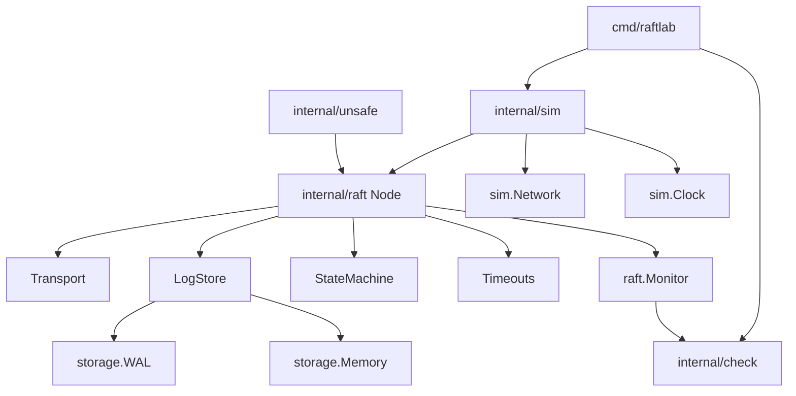

# 架构设计

## 系统概述

RaftLab 把 Raft 核心与一切不确定性隔开。核心只依赖四个接口：传输、时钟、日志存储、状态机。仿真层、真实 TCP、WAL、故障矩阵都是这些接口的实现。判定器旁路观察消息、持久化和 apply，不参与协议决策。

## 技术栈

- Go 1.22+
- 标准库 only（M0）；后续线性一致交叉验证引入 porcupine
- Makefile + GitHub Actions CI

## 项目结构（建议）

```text
internal/raft/        选举/复制/持久化/快照/不变量（禁止 time/net/sim）
internal/storage/     WAL + 内存 LogStore
internal/sim/         虚拟时钟、调度器、sim 传输、集群、故障矩阵
internal/transport/   Transport 接口的 tcp 实现（M 后期）
internal/check/       历史、线性一致、种子收缩
internal/unsafe/      8 个故意写错的变体
cmd/raftlab/          CLI 与 gate 命令
cmd/importcheck/      CI 强制 import 图
docs/PROGRESS.md      每个 gate 的原始输出
reports/failures/     收缩后的失败种子
```

## 核心模块/组件

- **raft.Node**: 单节点状态机，Step 驱动，无 goroutine
- **sim.Scheduler**: 单线程事件堆，超时 = 调度器发时钟事件
- **sim.Network**: 延迟/丢包/分区/重复，同一套故障 API
- **storage.WAL**: 带校验和记录，撕裂写截断到合法前缀
- **raft.Monitor**: 运行时不变量 I1–I9
- **check**: 客户端历史 + Wing–Gong / porcupine

## 架构图



## 关键流程

1. 调度器弹出下一事件，推进虚拟时钟
2. 定时器事件变成 `MsgTickElection` / `MsgTickHeartbeat` 进入 `Node.Step`
3. 节点通过 Transport.Send 发出消息，Network 按故障规则投递或丢弃
4. Observer 记录状态/发送/持久化/apply，Monitor 检查不变量
5. 事件日志规范化后哈希；同种子跑两遍必须字节一致

## 设计决策

- 依赖单向：raft 看不到 sim。不确定性只从接口进来。
- 每个参与者独立派生 RNG：加节点不扰动既有流。
- 活性只报告不断言：精确时序断言必然 flaky。
- 不变量报警改协议，不改不变量。
- Gate 不过不许进下一里程碑。
