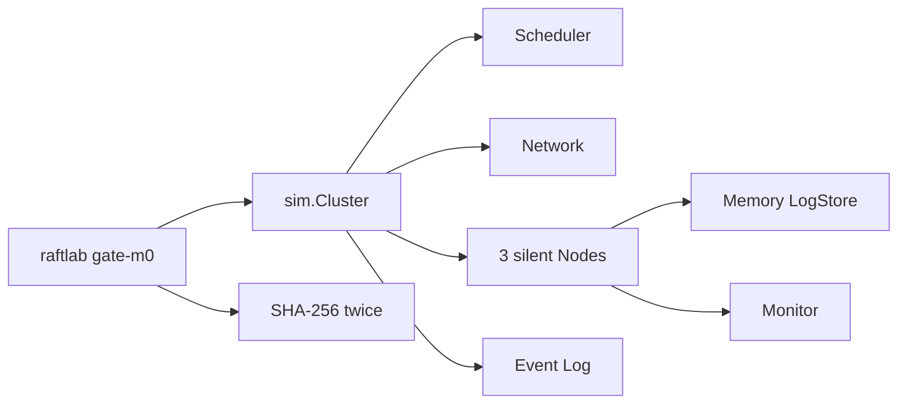

# M0 Skeleton

Feature Name: m0-skeleton
Updated: 2026-09-29

## Description

Interfaces, deterministic simulator, WAL, invariant monitor, import-graph CI, and the M0 replay gate.

## Architecture

## Components and Interfaces

- `raft.Node.Step` is the only entry: timers, RPCs, client proposals
- `sim.Scheduler` owns the event heap; timeouts are scheduled clock events
- `sim.Network.Send` applies drop/delay/dup/partition then enqueues deliver
- `storage.WAL` frames: magic + kind + len + crc32c + payload
- `cmd/importcheck` walks `internal/raft` and fails on forbidden imports

## Data Models

- `Message` is the RPC envelope; `Canonical()` feeds the event log
- `HardState` is {Term, VotedFor, Commit}
- Event log line: `seq at kind line`

## Correctness Properties

- Same seed => identical canonical log
- WAL torn write => valid prefix
- WAL checksum fail => hard error
- I1/I2/I3/I9 evaluated on every state/send/apply (may be vacuously true on silent nodes)

## Error Handling

- Corrupt WAL returns `ErrCorruptWAL`; never silently accept a bad record
- Torn tail is truncated to last good offset
- Gate mismatch prints both hashes and event counts

## Test Strategy

- `internal/sim.TestThreeSilentNodesReplayByteIdentical` seeds 1,2,7,42,99
- `internal/storage` WAL replay, torn write, checksum
- `internal/raft.TestNoForbiddenImports`
- `raftlab gate-m0` is the documented gate

## References

- Ongaro, D., Ousterhout, J. In Search of an Understandable Consensus Algorithm (Raft)
- MonkeyCode guardrails: gate output into docs/PROGRESS.md; no sleep to hide flakes
